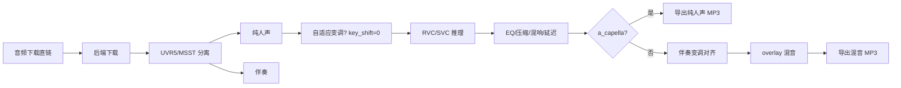

# RVCSVC-API-Pro 🎤

基于 Gradio 的 AI 翻唱一体化服务：接收**音频下载直链**，自动完成「下载 → 人声分离（UVR5/MSST）→ RVC/SVC 变声推理 → 专业音效后处理 → 混音导出 MP3」，并对外开放 Gradio API 供外部程序（如 AstrBot 插件）调用。

> 本项目默认使用自带的 `runtime/` 便携 Python（Windows 绿色版），无需另装环境。

---
## 部署方法
- **整合包下载**：[Hugging Face](https://1822487561.share.123pan.cn/123pan/0pVJjv-6dE9H) 或者 [直链ViKiNG FiLE](https://vikingfile.com/f/bycbEh5I2s#RVCSVC)或者[国内访问123pan](https://1822487561.share.123pan.cn/123pan/0pVJjv-6dE9H) **下载**后解压运行`启动 rvcapi.bat`即可使用。
- **依赖的模型**：[RVC-Project](https://github.com/RVC-Project/Retrieval-based-Voice-Conversion-WebUI) **注意：**需要运行RVC模型中`go-webui.bat`再启动本项目中`启动 rvcapi.bat`。
## 目录

- [特性](#-特性)
- [项目结构](#-项目结构)
- [运行环境](#-运行环境)
- [前置依赖：先启动 RVC / SVC WebUI](#-前置依赖先启动-rvc--svc-webui)
- [模型文件放置规则](#-模型文件放置规则)
- [模型文件获取](#-模型文件获取)
- [启动服务](#-启动服务)
- [Web 界面使用](#-web-界面使用)
- [API 调用（供外部程序对接）](#-api-调用)
- [参数说明](#-参数说明)
- [自适应变调（RMVPE GPU 加速）](#-自适应变调rmvpe-gpu-加速)
- [清唱模式](#-清唱模式)
- [工作原理](#-工作原理)
- [音频后处理链](#-音频后处理链)
- [缓存机制](#-缓存机制)
- [常见问题](#-常见问题)
- [许可证 / 致谢](#-许可证)

---

## ✨ 特性

- 🎵 **双引擎**：RVC（`app_rvc.py`，端口 7860，代理 RVC WebUI 7897）与 SoVITS-SVC（`app_svc.py`，端口 7866，代理 so-vits-svc WebUI 7865）
- 🔗 **直链输入**：只接受可直接下载的音频 URL（mp3/wav/flac/m4a/ogg），支持第三方接口给出的 `music_url`
- 🧩 **三种人声分离模型**：
  - `VR-HP5 (默认)` — UVR5 高速分离
  - `MSST BS-Roformer` — 高精度单模型分离
  - `MSST 串联管线 (becruily_deux + 去混响)` — 两步提干声 + 去混响
- 🎚️ **F0 音高提取算法可选**：`rmvpe`（默认，精度最高）/ `pm`（旧版）/ `fcpe`（全卷积轻量）
- 🎯 **自适应变调**：根据分离出的纯人声 F0 + 舒适区音域自动计算最优升降调（`±12` 钳制）；F0 提取**优先走 RMVPE GPU 快路径**（`adaptive_pitch.py` + 同级 `rmvpe.pt` + `infer/rmvpe.py`），失败自动回退 `librosa.pyin`（CPU）
- 🎤 **清唱模式**：推理完人声后不合成伴奏，直接输出纯人声（保留混响/延迟/压缩/响度归一化效果）
- 🎛️ **专业音效链**：EQ（高通/低通/三频 PeakFilter）+ 压缩 + 混响 + 延迟（可选）
- 🔁 **智能缓存**：同一首歌（直链做缓存键）的分离结果会落在 `output/`，重跑跳过下载/分离
- 🌐 **Web UI + Gradio API**：浏览器操作或外部程序 `/convert` 调用

---

## 📦 项目结构

```
RVCSVC-API/
├── app_rvc.py          # RVC 版主程序（直链模式）
├── app_svc.py          # SoVITS-SVC 版主程序
├── msst_backend.py     # MSST 串联/BS-Roformer 分离后端
├── adaptive_pitch.py   # 自适应变调脚本（RMVPE GPU 快路径，可独立运行）
├── rmvpe.pt            # RMVPE 音高提取模型（GPU 快路径用）
├── infer/              # RVC 推理模块（rmvpe.py / fcpe.py / hubert.py / rtrvc.py ...）
├── uvr5/               # UVR5 分离模块
│   └── uvr_model/      # 分离模型文件（自动下载）
├── msst/               # MSST 模型权重与配置
├── runtime/            # 自带 Python 便携运行时（Windows）
│   ├── python.exe
│   ├── ffmpeg.exe / ffprobe.exe
│   └── Lib/
├── output/             # 分离后的人声/伴奏缓存
├── temp/               # 最终输出 MP3
├── requirements.txt
├── 启动 rvcapi.bat     # RVC API 启动脚本（已带 NO_PROXY 代理绕过）
├── 启动 svcapi.bat     # SVC API 启动脚本
├── 使用说明.txt        # 模型文件放置的简短备忘
└── 要使用svcapi请把文件夹里的文件替换到svc根目录/  # SVC API 对接补丁
```

> `adaptive_pitch.py`、`rmvpe.pt` 必须与 `app_rvc.py` **同级**（即 `RVCSVC-API/` 根目录），`infer/rmvpe.py` 在 `infer/` 目录下；缺失任一项时自适应变调自动回退 `librosa.pyin`（CPU），不阻断主流程。

---

## 🚀 运行环境

- **Windows**：直接用自带 `runtime\python.exe`，无需另装 Python
- **Linux/macOS**：Python 3.10+，CUDA 11.8+（有 GPU 时）
- 内存 ≥ 4 GB

依赖（已包含在 `requirements.txt`）：

```
torch / torchaudio（按 GPU 选 cu118 或 cpu 版）
librosa, numpy, soundfile, resampy
gradio, requests, tqdm, pydub
pedalboard
```

---

## ⚠️ 前置依赖：先启动 RVC / SVC WebUI

**RVCSVC-API 本身不加载推理模型，而是代理到本地 WebUI 的推理端点。** 必须先启动对应 WebUI：

| 程序 | 代理目标 | 端点 |
|---|---|---|
| `app_rvc.py` | RVC WebUI | `http://127.0.0.1:7897`（`/run/infer_convert`） |
| `app_svc.py` | so-vits-svc WebUI | `http://127.0.0.1:7865`（`/run/run_inference`） |

若你改了 WebUI 端口，修改对应 `app_*.py` 顶部的 `RVC_API_BASE` / `SVC_API_BASE`。

### 使用 SVC API 的额外步骤

`so-vits-svc` 的 `app.py` 没有开放推理 API，需要把本项目里
`要使用svcapi请把文件夹里的文件替换到svc根目录/app.py` **覆盖**到 so-vits-svc 根目录，
并在 WebUI 中切换到「**独立目录模式**」。

---

## 📁 模型文件放置规则

> 原则：**文件直接放在指定目录，不要嵌套子文件夹；index/扩散/配置文件的命名要与模型文件名一致（去掉前缀）。**
> 所有模型权重（`.pth` / `.pt` / `.ckpt`）都不进 git 仓库，按下表各自获取后放到位。

### 模型文件获取

| 文件 | 放哪 | 获取来源 |
|---|---|---|
| RVC 的 `xxx.pth` | `RVC项目路径\assets\weights\` | 你自训的模型，或从 ModelScope/HuggingFace 下载 |
| RVC 的 `xxx.index` | `RVC项目路径\log\` | 与 `.pth` 同名（去 `added_IVF4949_Flat_nprobe_1_` 前缀） |
| `rmvpe.pt`（F0 提取，~173MB） | `RVCSVC-API\` 根目录 | 从 [RVC-Project](https://github.com/RVC-Project/Retrieval-based-Voice-Conversion-WebUI) 的 `rmvpe` 模型下载（或其 ModelScope 镜像）；没有它则自适应变调自动回退 CPU 的 `librosa.pyin`（不影响出结果，只是慢） |
| UVR5 `5_HP-Karaoke-UVR.pth` | `RVCSVC-API\uvr5\uvr_model\` | **首次启动自动下载**（ModelScope），无需手动 |
| MSST 模型（`.ckpt`/`.yaml`） | `RVCSVC-API\msst\pretrain\` | 仓库已含配置；权重放 `msst/pretrain/vocal_models\`、`msst/pretrain/dereverb_models\`；也可设环境变量 `PYMSS_STUDIO_DIR` 指向外部 Pymss-Studio 目录 |
| SVC 的 `xxx.pth`/`.yaml`/扩散 | `svc项目路径\models\` | 你自训的模型 |

### RVC（`app_rvc.py`）

| 文件 | 放置位置 | 命名 |
|---|---|---|
| `.pth` 模型 | `RVC项目路径\assets\weights\` | 与模型同名（如 `wuxiV1.pth`） |
| `.index` 索引 | `RVC项目路径\log\` | 与模型同名（如 `wuxiV1.index`） |

- 训练默认会生成 `added_IVF4949_Flat_nprobe_1_模型名.index`，请**把 `added_IVF4949_Flat_nprobe_1_` 前缀删掉**，只留与模型名一致的后缀。
- 配置文件 `.json` 同名放在 WebUI 可识别位置。

### SVC（`app_svc.py`）

| 文件 | 放置位置 | 命名 |
|---|---|---|
| `.pth` 模型 | `svc项目路径\models\` | 与模型同名 |
| 配置 `.yaml` | `svc项目路径\models\` | 与模型同名 |
| 扩散 `.pth` | `svc项目路径\models\diffusion\` | 与模型同名 |

模糊匹配阈值 40%（`threshold=0.4`），名字差别太大时匹配不到会报「未找到匹配的 index」。

---

## ▶️ 启动服务

```bash
# Windows（推荐，自带 runtime + 代理绕过）
启动 rvcapi.bat

# 或直接调用 runtime
RVCSVC-API\runtime\python.exe RVCSVC-API\app_rvc.py

# Linux/macOS
python app_rvc.py          # RVC
python app_svc.py          # SVC
```

CPU 模式（无 GPU / 不想用 fp16）：

```bash
python app_rvc.py --is_nohalf
python app_svc.py --is_nohalf
```

首次启动会自动下载 UVR5 分离模型（约 120 MB），请耐心等待。

启动成功后访问：

- RVC：`http://127.0.0.1:7860`
- SVC：`http://127.0.0.1:7866`

> **代理绕过**：`启动 rvcapi.bat` / `启动 svcapi.bat` 已内置 `NO_PROXY=localhost,127.0.0.1,0.0.0.0,::1`。若系统代理（Clash/V2Ray 等）拦截了 7860，Gradio 启动自检（`startup-events`）会 502 导致起不来——用这两个 `.bat` 启动即可绕过；若仍被系统级代理拦截，需在代理软件里把 `127.0.0.1` / `localhost` / `7860` 加入 TUN bypass。

---

## 🖥️ Web 界面使用

1. **刷新模型列表**：点 🔄「刷新」加载可用模型
2. **选择/加载模型**：下拉选模型，点 ✨「切换模型」
3. **填写音频下载直链**：一个可直接下载的 mp3/wav/flac/m4a URL
4. **选择分离模型（UVR）**：
   - `VR-HP5 (默认)`
   - `MSST BS-Roformer`
   - `MSST 串联管线 (becruily_deux + 去混响)`
5. **选择音高提取算法（F0）**：`rmvpe` / `pm` / `fcpe`
6. **自适应变调**：勾选「自适应变调」并填写舒适区低音/高音（如 A3 / A5）；若升降调为 0，后端会自动算最优升降调（`±12` 内钳制）
7. **清唱模式**：勾选「清唱模式（不合成伴奏）」，推理完只出纯人声
8. **调参**：
   - 升降调 `-12 ~ +12`（推荐女唱男 +6，男唱女 −6；伴奏会自动对齐）
   - 人声/伴奏音量 `-3 ~ +3` dB
   - 混响强度 `0 ~ 10`（0 干声，4 默认，10 宏大）
   - 回声（延迟）`0 ~ 10`（0 关闭）
9. **开始转换**：点 💕 按钮，等控制台打印「已导出」即完成，左侧播放器出结果

---

## 📡 API 调用

Gradio 暴露 `api_name`：`/convert`（RVC）与 `/convert`（SVC）、`/show_model`。

### RVC（`app_rvc.py`，端口 7860）

`/convert` 接受 **13 个参数**，顺序与 Web UI 一致：

```
[direct_link, key_shift, vocal_vol, inst_vol, model, reverb, delay,
 uvr_choice, f0_method, adaptive_shift, comfort_low, comfort_high, a_capella]
```

```python
from gradio_client import Client

client = Client("http://127.0.0.1:7860/")
result = client.predict(
    "https://example.com/song.mp3",   # 音频下载直链
    0,                                 # key_shift 升降调（半音，0~±12）
    0,                                 # vocal_vol 人声音量（dB）
    0,                                 # inst_vol 伴奏音量（dB）
    "wuxiV1.pth",                      # model RVC 模型名
    4,                                 # reverb 混响强度（0~10）
    0,                                 # delay 回声（0~10）
    "VR-HP5 (默认)",                  # uvr_choice 分离模型（字符串全等）
    "rmvpe",                           # f0_method 音高提取算法
    True,                              # adaptive_shift 是否启用自适应变调
    "A3",                              # comfort_low 舒适区低音
    "A5",                              # comfort_high 舒适区高音
    False,                             # a_capella 清唱模式（True=不合成伴奏）
    api_name="/convert",
)
print(result)   # 输出 MP3 的本地路径，需通过 /gradio_api/file= 下载
```

> ⚠️ `uvr_choice` 是**字符串全等**判断，必须原样写这三个值之一：
> `VR-HP5 (默认)` / `MSST BS-Roformer` / `MSST 串联管线 (becruily_deux + 去混响)`。
> 写错一个字符会被静默回退到 VR-HP5。

### SVC（`app_svc.py`，端口 7866）

SVC 的 `/convert` 参数较少（固定 F0 为 `fcpe`，无 UVR/F0/自适应/清唱选项）：

```python
client = Client("http://127.0.0.1:7866/")
result = client.predict(
    "https://example.com/song.mp3",
    0,
    "speaker0",                        # speaker_id
    api_name="/convert",
)
```

### 获取模型列表

```python
client = Client("http://127.0.0.1:7860/")
print(client.predict(api_name="/show_model"))
# ['wuxiV1.pth', 'guanguanV1.pth', ...]
```

---

## 🎚️ 参数说明

| 参数 | 取值 | 说明 |
|---|---|---|
| `direct_link` | http(s) URL | 音频下载直链，后端直接下载并做缓存键 |
| `key_shift` | −12 ~ +12 | 人声/伴奏升降调（半音）；`>6` 或 `<−6` 会自动 `optimize_pitch_shift` 折叠 |
| `vocal_vol` / `inst_vol` | −3 ~ +3 | 人声/伴奏音量（dB） |
| `model` | 模型文件名 | RVC `.pth` 名（如 `wuxiV1.pth`），模糊匹配 index |
| `reverb` | 0 ~ 10 | 混响强度，0 干声 / 4 默认 / 10 宏大 |
| `delay` | 0 ~ 10 | 回声（延迟）强度，0 关闭；内部映射 0.5s 延迟、mix 最高 0.35 |
| `uvr_choice` | 三个固定字符串 | 见上，全等匹配 |
| `f0_method` | `rmvpe`/`pm`/`fcpe` | 音高提取算法 |
| `adaptive_shift` | bool | 为 True 且 `key_shift==0` 时启用自适应变调 |
| `comfort_low` / `comfort_high` | 音名（如 A3/A5） | 自适应变调的舒适区音域 |
| `a_capella` | bool | 清唱模式，True 时跳过伴奏合成 |

---

## 🎯 自适应变调（RMVPE GPU 加速）

`app_rvc.py` 通过 `importlib` 动态加载**同级**的 `adaptive_pitch.py`：

1. 用 **RMVPE 模型**（`rmvpe.pt` + `infer/rmvpe.py`）提取分离后纯人声的帧级 F0
   - **GPU 快路径**：`RMVPE` 在 `cuda:0` 上跑 fp32，整首歌的人声 F0 提取比 pyin 快得多
   - **自动回退**：缺 `rmvpe.pt` / `infer/rmvpe.py` / GPU 不可用时，回退 `librosa.pyin`（CPU）
   - `adaptive_pitch.py` 会向 `sys.modules` 注入最小桩（`tools.cuda_graph` passthrough、`configs.config` 设备/dtype），不修改任何文件，使 RMVPE 模块在 RVCSVC-API 目录结构下也能正常加载
2. 计算加权中位数，对比舒适区中心（`(low+high)/2`）
3. 在 ±1 候选内按「变调后中位数离中心最近 → 覆盖率最高 → 幅度最小」选最优
4. 结果钳制在 `±12` 半音（RVC 允许范围）
5. 任何异常（文件不存在、加载失败、无有效 F0）都回退 `0`，不阻断主流程

`adaptive_pitch.py` 也可独立运行：

```bash
python adaptive_pitch.py vocals.mp3 --low A3 --high A5
# 加 --quiet 只输出一个整数变调值
# 加 --no-rmvpe 强制走 pyin（不尝试 RMVPE GPU）
```

---

## 🎤 清唱模式

`a_capella=True` 时，`convert()` 在推理完人声、做完 EQ/压缩/混响/延迟/响度归一化后，
**跳过伴奏加载、伴奏变调、overlay 合成**，直接导出 `temp/{歌名}-清唱.mp3`（纯人声，保留所有音效）。
正常模式导出 `temp/{歌名}-RVC-AI翻唱.mp3`（人声+伴奏混音）。

---

## 🧱 工作原理



---

## 🎛️ 音频后处理链（`pedalboard`）

```python
Pedalboard([
    HighpassFilter(80),
    PeakFilter(200, gain_db=1.5, q=0.7),
    PeakFilter(3000, gain_db=2.0, q=1.0),
    PeakFilter(7000, gain_db=-3.0, q=2.0),
    LowpassFilter(16000),
    Compressor(threshold_db=-18.0, ratio=4.0, attack_ms=5.0, release_ms=150.0),
    # delay_intensity > 0 时追加 Delay（延迟 0.5s，feedback 0.25，mix 最高 0.35）
    Reverb(room_size=..., damping=0.4, wet_level=..., dry_level=..., width=0.8),
])
```

混响参数按 `reverb_intensity` 在 `0~4` / `4~10` 两段线性插值。响度归一化 `headroom=-1.0 dB`。

---

## 💾 缓存机制

分离结果缓存到 `output/`，以直链（清洗后前 80 字符）做键：

```
output/
├── UVR-HP5/{song_key}/
│   ├── vocal_{song_key}.wav_10.wav        # 人声
│   └── instrument_{song_key}.wav_10.wav   # 伴奏
└── MSST-BS-RoFormer/{song_key}/
    ├── {song_key}_vocals.wav
    └── {song_key}_other.wav
```

同一首歌重跑时跳过下载与分离，直接复用。注意：**缓存键是直链本身**，直链变了（如 jkapi 换源）就会重新分离。

---

## ❓ 常见问题

**Q: 提示「未能加载模型列表」**
A: 确认 RVC/SVC WebUI 已启动且端口正确（`RVC_API_BASE` / `SVC_API_BASE`）。

**Q: API 报「Value is not in the list of choices」**
A: `uvr_choice` / `f0_method` 等枚举参数传错。用「隐藏 API Convert」按钮对应的 `/convert`，参数顺序务必与 Web UI 一致；`uvr_choice` 要逐字符写对。

**Q: 音频质量不佳**
A: 调小 `key_shift`（避免跨度过大）、提高模型训练质量、或换 `rmvpe` F0 算法。

**Q: 直链下载失败**
A: 确认直链可匿名访问（VIP 歌曲加密直链通常不行）；检查网络。

**Q: Gradio 启动自检 502（startup-events 报错）**
A: 系统代理拦截了 7860。用 `启动 rvcapi.bat`（已带 `NO_PROXY` 绕过），或在代理软件里把 `localhost` / `127.0.0.1` / `7860` 加 TUN bypass。

**Q: 自适应变调没生效 / 走的是 pyin 不是 RMVPE**
A: 确认 `adaptive_pitch.py`、`rmvpe.pt` 在 `RVCSVC-API/` 根目录且 `infer/rmvpe.py` 存在；且 `adaptive_shift=True` 且 `key_shift==0` 才会触发。看后端日志有没有 `[RMVPE] 已加载: ... @ cuda:0`——没有就是回退到了 pyin（缺文件或缺 GPU）。

**Q: 清唱模式没跳过伴奏**
A: 确认 `a_capella=True` 传到第 13 个参数位置；后端需重启才能识别新参数。

---

## 📄 许可证

本项目仅供学习、研究和个人娱乐使用。请勿用于商业用途或生成侵害他人权益的内容；使用者对生成内容自行承担法律责任。

## 🙏 致谢

- [RVC-Project](https://github.com/RVC-Project/Retrieval-based-Voice-Conversion-WebUI) — RVC 模型
- [so-vits-svc](https://github.com/svc-develop-team/so-vits-svc) — SVC 模型
- [Ultimate Vocal Remover](https://github.com/Anjok07/ultimatevocalremovergui) — 人声分离
- [Gradio](https://github.com/gradio-app/gradio) — Web 界面框架
- 项目作者 [CCYellowStar](https://www.modelscope.cn/models/CCYellowStar/RVCSVC-API)
- 项目贡献者 [ABCwewe](https://github.com/ABCwewe/RVCSVC-API)
